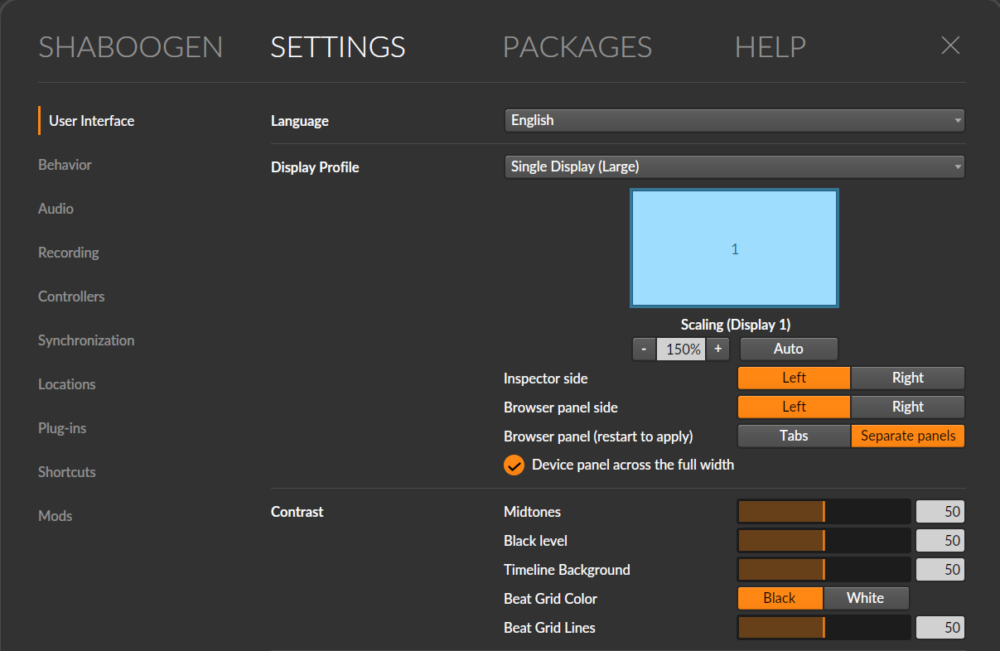
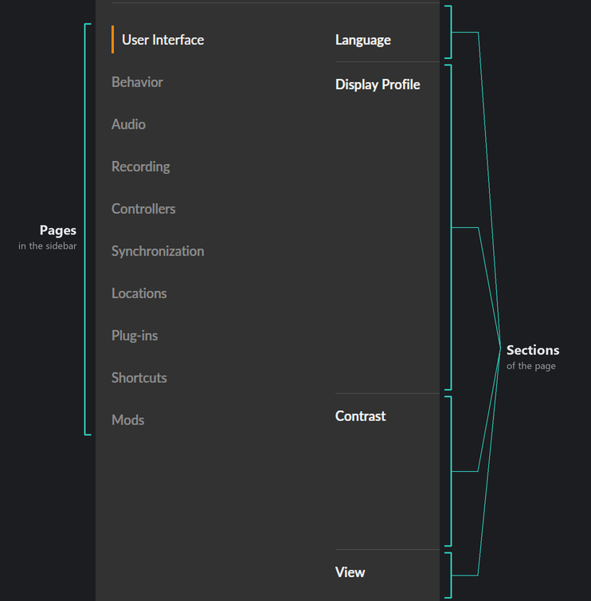

# Framework: Settings

Like most of Patchbay's framework mods, Framework: Settings doesn't do a great deal on its own. Framework: Settings provides an API that can be used by a modder to place options within Bitwig's existing Settings sections, in new sections on existing pages, or on entirely new Settings pages.

If you're a standard user who has no interest in writing their own mods, you can probably close this readme right now and go on with your day. If you're a modder, the rest of this will talk about the specific capabilities of the framework and how you can take advantage of them for your own mods.



- Mod ID: `preferences-composition-framework`. Java package: `bml.preferences`.
- Built against Bitwig 6.1.4; prepares on Bitwig 6.0 to 6.1.4.
- Needs Patchbay 0.34.0-dev.7 or later (manifest `registrations`, `bml.api.Bml`).

## Adding a control

Controls are the input paradigm of the Settings page. They are not recreations of native functions that look and act a bit like their counterparts, but are specifically exactly the same. This means that if you create a control within an existing menu, it will fit in with the rest of the controls around it.

A mod adds controls in three steps.

**1. Register with the framework in `mod.json`:**

```json
"registrations": [
  {
    "id": "preferences",
    "consumer": "preferences-composition-framework",
    "descriptor": "preferences.properties",
    "jar": "helper.jar"
  }
]
```

**2. Add the descriptor** (`preferences.properties`) to the mod's `package/` folder, so it lands next to `mod.json`:

```properties
api.version=1
provider.class=com.example.mymod.MySettings
```

**3. Write the provider** in the mod's helper jar. Compile against the framework's helper jar (`"classpath_mods": ["preferences-composition-framework@<version>"]` in `build.json`).

```java
package com.example.mymod;

import bml.preferences.Page;
import bml.preferences.PreferenceProvider;
import bml.preferences.Preferences;
import bml.preferences.Section;

public final class MySettings implements PreferenceProvider {
    @Override
    public void declare(Preferences preferences) {
        // In one of Bitwig's sections, below Bitwig's own controls.
        preferences.checkbox("open_window", "Open plug-in window on insert")
                   .in(Section.of("behaviour/device"))
                   .value(MyMod::openWindow, MyMod::setOpenWindow);

        // In a new section on one of Bitwig's pages.
        Section mine = preferences.section(Page.USER_INTERFACE, "my_mod", "My Mod");
        preferences.number("track_height", "Minimum track height", 20, 200).wholeNumbers()
                   .in(mine)
                   .value(MyMod::trackHeight, MyMod::setTrackHeight);

        // On a page of the mod's own.
        Page page = preferences.page("my_mod", "My Mod");
        Section general = preferences.section(page, "general", "General");
        preferences.choice("count_in", "Count-in", "None", "1 bar", "2 bars").in(general)
                   .value(MyMod::countIn, MyMod::setCountIn);
    }
}
```

The provider class must be public with a public no-argument constructor. The framework calls `declare` once, when Bitwig first builds its Settings.

## What controls can I access?

| Call                                     | Bitwig's widget                                                    | Value                                                                      |
| ---------------------------------------- | ------------------------------------------------------------------ | -------------------------------------------------------------------------- |
| `checkbox(controlId, label)`             | A checkbox with its label, as in Bitwig's own sections             | `.value(BooleanSupplier, Consumer<Boolean>)`                               |
| `choice(controlId, label, options...)`   | A row of option buttons, one selected (as Bitwig's Pre-roll)       | `.value(IntSupplier, IntConsumer)`: the selected option's position, from 0 |
| `dropdown(controlId, label, options...)` | A dropdown list, one selected                                      | as `choice`                                                                |
| `number(controlId, label, min, max)`     | A number field, dragged or typed (as Bitwig's New track volume)    | `.value(DoubleSupplier, DoubleConsumer)`                                   |
| `slider(controlId, label, min, max)`     | A slider with a number field beside it (as Bitwig's Contrast rows) | as `number`                                                                |

<!-- image: one section with each control type (checkbox, option buttons, dropdown, number field, slider), labels in one column -->

Every control needs an `.in(Section)` and a `.value(...)`.

- `number` and `slider` take `.wholeNumbers()`: the value is rounded and shown without decimals, between the smallest whole number at or above `min` and the largest at or below `max`.
- `number` and `slider` take `.decibels()`: the value is shown as Bitwig's decibel fields show theirs, for example `-60.0 dB`. The value you read and write is in decibels.
- Every control except a checkbox is a labelled row: the label on the left, the widget on the right. As on Bitwig's own pages, labels take a column 185 px wide. When a label is wider, that section's label column widens to it, so the section's widgets still start at one x.

It's important to understand that values are stored within your mod and not in the framework. The framework only provides a mechanism for you to show the value to a user and give them a way to alter it. Bitwig calls the getter whenever it shows the control, and the setter when the user changes it. Keep the value where the mod keeps its other settings (normally `MOD.settings()`), so it lasts across restarts.

- A `number` or `slider` value is kept between `min` and `max`. A `choice` or `dropdown` getter that returns a position out of range shows the first option.
- Options are shown as written. Their positions are what the mod stores, so add new options at the end.
- `controlId` only needs to be unique within the mod; it names the control in the log.
- A value the mod changes elsewhere while Settings is open shows when Bitwig next redraws the control or rebuilds the page.

## Sections and Pages



- `Section.of(sectionId)` is one of Bitwig's sections, by its ID below, or a section any mod declared.
- `preferences.section(page, sectionId, title)` declares a new section on a page, headed by `title`. Its ID is `<page ID>/<sectionId>`.
- `preferences.page(pageId, label)` declares a page in the Settings sidebar, shown with `label` as written. `Page.of(pageId)` is a page any mod declared.

Page and section IDs are shared by all mods in Patchbay. A page is identified by its page ID, and a section by its page ID and section ID together (written page/section), so the same section ID can be used on different pages. However many times an ID is declared, the framework resolves it as one page or one section, and any mod can add controls to it. IDs are letters, digits, `_`, `.` and `-`, starting with a letter.

Bitwig's pages: `Page.USER_INTERFACE` (`user-interface`), `BEHAVIOUR` (`behaviour`), `AUDIO` (`audio`), `RECORDING` (`recording`), `CONTROLLERS` (`controllers`), `SYNCHRONIZATION` (`synchronization`), `LOCATIONS` (`locations`), `PLUGINS` (`plugins`), `SHORTCUTS` (`shortcuts`).

Bitwig's sections (the heading is what Bitwig shows in English):

| Page            | Section ID                               | Heading                                                                     |
| --------------- | ---------------------------------------- | --------------------------------------------------------------------------- |
| User Interface  | `user-interface/language`                | Language                                                                    |
|                 | `user-interface/display-profile`         | Display Profile                                                             |
|                 | `user-interface/contrast`                | Contrast                                                                    |
|                 | `user-interface/view`                    | View                                                                        |
|                 | `user-interface/mouse`                   | Mouse                                                                       |
|                 | `user-interface/transport`               | Transport                                                                   |
| Behaviour       | `behaviour/update-notifications`         | Update notifications                                                        |
|                 | `behaviour/open-on-start`                | Open on start                                                               |
|                 | `behaviour/template`                     | Template                                                                    |
|                 | `behaviour/audio-import`                 | Audio Import and Preview                                                    |
|                 | `behaviour/defaults`                     | Defaults                                                                    |
|                 | `behaviour/fades`                        | Fades                                                                       |
|                 | `behaviour/sequencer`                    | Sequencer                                                                   |
|                 | `behaviour/device`                       | Device                                                                      |
|                 | `behaviour/solo`                         | Solo                                                                        |
|                 | `behaviour/select-tracks`                | Select tracks when                                                          |
|                 | `behaviour/play-start-marker`            | Move the Play Start Marker                                                  |
|                 | `behaviour/resume-playback`              | Resume Playback                                                             |
|                 | `behaviour/usage-data`                   | Help improve Bitwig Studio                                                  |
| Recording       | `recording/recording`                    | Recording                                                                   |
|                 | `recording/arranger-parameter-recording` | Arranger Parameter Recording                                                |
|                 | `recording/auto-arm`                     | Auto-arm                                                                    |
|                 | `recording/pre-roll`                     | Pre-roll                                                                    |
|                 | `recording/record-quantization`          | Record quantization                                                         |
|                 | `recording/created-audio`                | Created Audio                                                               |
| Controllers     | `controllers/takeover-mode`              | Takeover mode                                                               |
|                 | `controllers/controllers`                | Controllers (mod controls sit under the heading, above the controller list) |
| Synchronization | `synchronization/transport-sync`         | Transport Sync (IN)                                                         |
|                 | `synchronization/midi-sync`              | MIDI Sync (OUT)                                                             |
| Locations       | `locations/downloaded-packages`          | Downloaded Packages                                                         |
|                 | `locations/analysis-cache`               | Audio Analysis Cache                                                        |
| Plug-ins        | `plugins/interface-scaling`              | Plug-in Interface Scaling                                                   |
| Shortcuts       | `shortcuts/edit-shortcuts-for`           | Edit shortcuts for                                                          |

The Audio page has no section a mod can add to; new sections work on every page, Audio included.

## Where controls appear

As the Settings menu is a common area that multiple mods will attempt to add controls to, the framework decides position according to the following rules:

- **In a section**, mod controls come after Bitwig's own. They are first grouped by mod name (alphabetical order) then by mod ID in the case of a name match. Each mod's controls keep the order it declared them.

- **New sections** are added below Bitwig's existing sections on the page after a divider. These are sorted alphabetically by the section's label.

- **Mod pages** are added after Bitwig's pages in the sidebar. These are sorted alphabetically by the page's label. Sections within new pages are sorted alphabetically by the section's label.

- A new section or page is shown only when at least one control is in it.

- A new section can't be placed between Bitwig's sections.

## Behaviour and failures

- `declare`, getters and setters run on Bitwig's UI thread so it's important to keep them short. While Settings is open, getters run whenever Bitwig redraws a control. While Settings is closed, the framework does nothing.
- A registration whose descriptor is missing or invalid, a provider class that can't be loaded or a provider that throws is logged (`[preferences-composition-framework] ...`) and that mod's controls are skipped. Other mods are unaffected.
- A control without `.in(...)` or `.value(...)`, with an ID the mod already used, or a whole-number control with no whole number between `min` and `max` is logged and skipped. A control in a section or page nobody declared is logged and not shown.
- A section or page ID declared twice with different titles uses the first (by mod ID), logged. A new section can't take the ID of one of Bitwig's sections, nor a new page one of Bitwig's pages.
- A getter that throws is logged and shows `false`, the first option or the lowest value; a setter that throws is logged and the control shows the getter's value. A control whose widget can't be built is left out of that section.
- If the framework can't add to one of Bitwig's sections on the installed version, that section is shown as Bitwig builds it and everything else works.
- Turning the framework off removes the controls. As a mod's values are not stored in the framework, they will still work but the control to set them will not be drawn.
- Nothing is written into projects meaning this framework has no impact on compatibility with non-modded versions of Bitwig.
